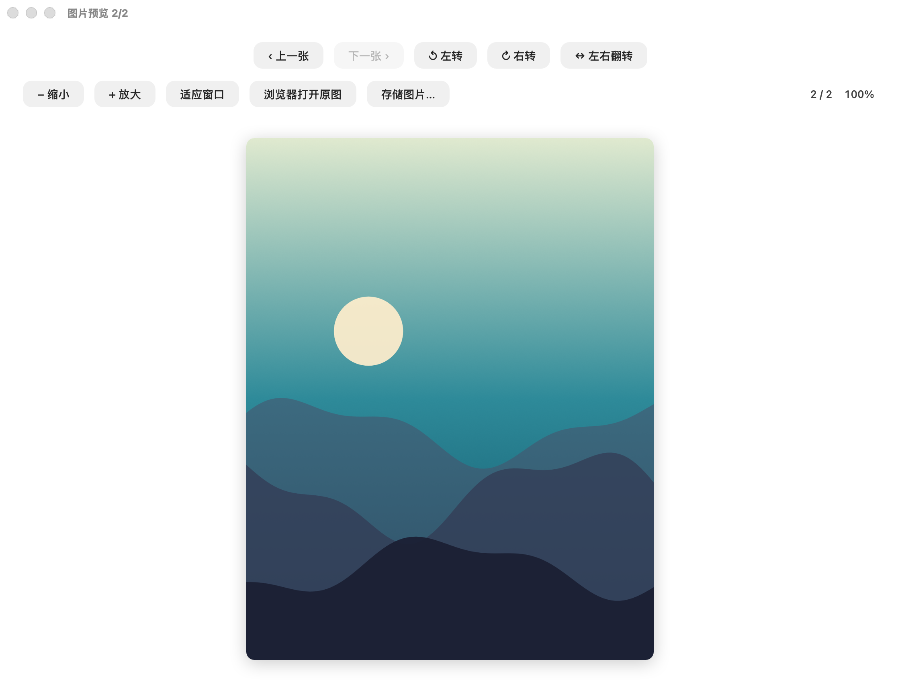

# SeeImage · 图片查看器

从 [上门超人](https://updoor.cn) macOS 客户端里单独拆出来的图片预览窗口：轻量、原生 AppKit，没有 WebView、没有第三方依赖。



## 功能

- **图集浏览**：工具栏「上一张 / 下一张」，或直接左右滑动图片翻页；右下角显示 `当前 / 总数` 与缩放比例。
- **缩放**：工具栏放大 / 缩小、触控板双指捏合、`⌘ + 滚轮` 以光标为中心缩放、双击在 100% 和 200% 之间切换；放大后可拖动平移。
- **旋转 / 翻转**：「左转」「右转」按 90° 旋转，「左右翻转」水平镜像，旋转后自动重新适配窗口。
- **适应窗口**：一键回到完整显示。
- **浏览器打开原图**：网址图片交给默认浏览器打开；本地文件用系统默认浏览器（如 Chrome、Safari）打开。
- **存储图片…**：保存到本地，自动带出合理文件名；网络图片会先下载再写入。
- **拖拽**：把图片文件或网页里的图片地址拖进窗口即可查看；窗口为空时直接替换，已有图片时追加到图集。
- **右键菜单**：适应窗口、缩放、旋转、翻转、复制图片地址、在浏览器中打开原图、存储图片。

## 快捷键

| 操作 | 快捷键 |
| --- | --- |
| 上一张 / 下一张 | `←` / `→`（或 `⌘[` / `⌘]`） |
| 放大 / 缩小 | `+` / `-` |
| 适应窗口 | `0` |
| 向右旋转 | `r` |
| 向左旋转 | `⇧ r` |
| 左右翻转 | `f` |
| 存储图片 | `⌘S` |
| 打开图片 | `⌘O` |

## 安装

不想自己编译的话，可以直接下载 [Releases](https://github.com/Cyj-090900/seeimage/releases) 里打包好的 `SeeImage-macOS.zip`（Apple Silicon，macOS 13 及以上）。应用是本地 ad-hoc 签名、没有经过 Apple 公证，第一次打开请在 Finder 里右键 →「打开」。

也可以把 `.app` 拖进「应用程序」，之后就能像平常一样双击打开图片、拖图片进窗口或把图片拖到 Dock 图标上。

## 构建

只依赖 macOS 自带的 Swift 工具链（Xcode 或 Command Line Tools 任选其一），不需要 CocoaPods / SPM 依赖：

```bash
./scripts/build-app.sh          # 产物：build/SeeImage.app
open build/SeeImage.app
```

开发时也可以直接运行：

```bash
swift run SeeImage                     # 空窗口
swift run SeeImage ~/Pictures/a.png    # 打开本地图片
swift run SeeImage https://example.com/a.jpg
```

### 无界面截图

`--snapshot` 会把窗口离屏渲染成 PNG，CI 用它生成文档截图（需要能访问 WindowServer 的图形会话）：

```bash
swift run SeeImage --snapshot docs/preview.png
```

### 图标

`Resources/AppIcon.icns` 由脚本生成，修改配色后重新执行：

```bash
python3 scripts/make-icon.py    # 需要 Pillow + iconutil
```

## 目录结构

```
Sources/SeeImage/
  main.swift                      入口、--snapshot 分支
  AppDelegate.swift               窗口管理、菜单、命令行/Apple Event 打开
  ImagePreviewWindowController.swift  预览窗口：工具栏、加载、图集、保存
  ZoomableImageView.swift         画布：缩放、平移、旋转、翻转、滑动翻页
  PillButton.swift                胶囊工具栏按钮
  DropContainerView.swift         拖拽接收与高亮
  ImageItem.swift                 图集条目（本地文件 / 远程 URL）
  SampleImage.swift               程序化示例图（截图用，不依赖版权素材）
  SnapshotRenderer.swift          离屏渲染窗口为 PNG
Resources/Info.plist              App Bundle 配置
scripts/build-app.sh              打包 .app
scripts/make-icon.py              生成 .icns
.github/workflows/build.yml       CI：编译、截图、上传产物
```

## 说明

原 App 没有公开源码，这个仓库是按 0.8.4 版窗口的实际行为与界面重新实现的独立版本：保留同样的工具栏布局、按钮文案、缩放/旋转/翻转逻辑和图集交互，去掉了与网页桥接（`window.webkit.messageHandlers.updoorImagePreview`）相关的部分。

## License

[MIT](LICENSE)
