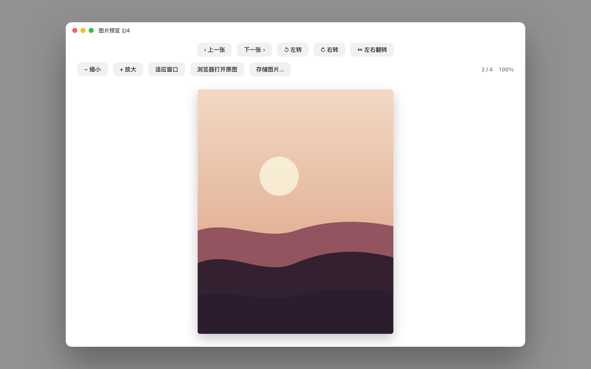
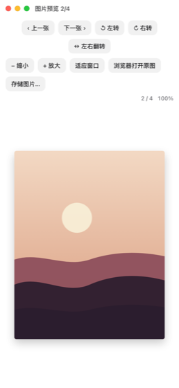

# SeeImage · 图片查看器

从 [上门超人](https://updoor.cn) macOS 客户端里单独拆出来的图片预览窗口。

现在的重点是 **`seeimage.js`**：一个单文件、零依赖的网页版查看器，把原生窗口的布局、按钮、缩放 / 旋转 / 翻转 / 图集交互完整复刻到浏览器里。想在别的页面里直接拿来用，只需要引入这一个文件。

在线示例：<https://cyj-090900.github.io/seeimage/demo.html>





## 快速开始

### 方式一：用 JS 打开一组图片

```html
<script src="seeimage.js"></script>
<script>
  SeeImage.open([
    "/gallery/1.jpg",
    "https://example.com/2.png"
  ], 0);
</script>
```

`open` 会返回一个小句柄，方便在业务里控制：

```js
const preview = SeeImage.open(images, 2);
preview.next();
preview.previous();
preview.close();
```

### 方式二：页面上的图片点一下就打开

```html
<div data-seeimage-gallery>
  
  
</div>

<script src="seeimage.js"></script>
<script>SeeImage.bind(document, "img");</script>
```

- 同一个 `[data-seeimage-gallery]` 容器里的图片自动成一组，左右翻页在组内切换。
- `data-seeimage` 写大图地址；不写就直接用 `src`。
- 缩略图包在 `<a href="大图">` 里也能用，点击不会跳转。
- `bind` 只绑定一次，重复调用不会叠加监听。

## 交互

和原生窗口保持一致，也补了触屏操作：

| 操作 | 效果 |
| --- | --- |
| 工具栏「上一张 / 下一张」、`←` / `→`、左右滑动、滚轮横向滚动 | 切换图集 |
| 工具栏「放大 / 缩小」、`+` / `-`、`⌘/Ctrl + 滚轮`、双指捏合 | 以光标 / 双指中心缩放 |
| 双击 | 在 100% 和 200% 之间切换 |
| 放大后拖动、单指拖动、滚轮 | 平移画面 |
| 「左转 / 右转」、`r` / `⇧ r` | 按 90° 旋转，并重新适应窗口 |
| 「左右翻转」、`f` | 水平镜像 |
| 「适应窗口」、`0` | 回到完整显示 |
| 「浏览器打开原图」 | 新标签页打开当前图片地址 |
| 「存储图片…」、`⌘/Ctrl + S` | 下载当前图片，自动带出文件名 |
| 拖入文件 / 图片地址 | 追加到图集并跳转 |
| `Esc`、点右上角红点、点遮罩 | 关闭 |

缩放比例以「适应窗口」为基准：显示 `100%` 时图片完整可见，`200%` 是适应尺寸的两倍。

## API

| 调用 | 说明 |
| --- | --- |
| `SeeImage.open(list, index?, options?)` | 打开查看器。`list` 可以是字符串数组，也可以是 `{ url, name }` 对象数组；`index` 是初始位置（默认 0）；返回 `{ next, previous, close, viewer }`。 |
| `SeeImage.close()` | 关闭当前查看器。 |
| `SeeImage.bind(root?, selector?)` | 事件委托绑定，默认 `root = document.body`、`selector = "[data-seeimage], img"`。 |
| `SeeImage.collect(scope?, selector?)` | 收集匹配元素的图片地址数组，适合自己组装 `list`。 |
| `SeeImage.version` | 版本号。 |
| `window.__seeimagePreviewSingle(url)` | 快捷方式，单张图片打开。 |

`options` 目前支持：

```js
SeeImage.open(images, 0, {
  onClose() {
    // 查看器关闭后回调
  }
});
```

## 实现说明

- **单文件、零依赖**：不引入框架、不打包、不加载外部 CSS 和字体，`seeimage.js` 直接 `<script>` 即可。
- **样式隔离**：整个界面放在 Shadow DOM 里，不会和宿主页面的 CSS 互相污染；`z-index` 取足够大的值，盖在常见弹层之上。
- **定位**：缩放以光标（或双指中点）为锚点，`offset' = point + (offset − point) × ratio`；图片始终保持居中布局，旋转 90°/270° 时按交换后的宽高重新计算适应比例。
- **手势不打架**：`touch-action: none` 只在画布上生效，单指拖动平移、超出边界时橡皮筋回弹，横向拖过 70px 触发翻页；双指捏合与页面滚动互不干扰。
- **下载**：优先 `fetch` 拿 blob 再用 `<a download>` 保存；跨域读不到时退化为新窗口打开原图。
- **细节**：按钮带 `title` 和 `aria-label`，`Esc` 关闭，打开时锁定页面滚动、关闭后恢复。

## 目录结构

```
seeimage.js                     网页版查看器（单文件，零依赖）
demo.html                       本地示例：卡片点开查看器
docs/web-preview.png            网页版截图
docs/web-mobile.png             移动端截图
Package.swift                   原生 macOS 版（SwiftPM）
Sources/SeeImage/               原生 AppKit 实现
Resources/                      原生版 Info.plist、图标
scripts/                        原生版打包、图标生成脚本
.github/workflows/build.yml     CI：编译原生版、截图、上传产物
```

## 原生 macOS 版（保留）

仓库里还保留了之前顺手做的原生版本：同样的工具栏、同样的快捷键，AppKit 实现，没有 WebView。日常用网页版就够；想要一个双击就能打开的 `.app` 时可以用它。


- 下载：[Releases](https://github.com/Cyj-090900/seeimage/releases) 里的 `SeeImage-macOS.zip`（Apple Silicon，macOS 13+，本地 ad-hoc 签名、未公证，首次打开请右键 →「打开」）。
- 自行构建：

```bash
./scripts/build-app.sh          # 产物：build/SeeImage.app
open build/SeeImage.app
```

- 开发运行与离屏截图：

```bash
swift run SeeImage ~/Pictures/a.png
swift run SeeImage --snapshot docs/preview.png
```

原生版细节（菜单、拖拽、右键菜单、图标生成）见源码；改动界面后可以在 CI 里重新生成 `docs/preview.png`。

## 说明

原 App 没有公开源码，这个仓库是按 0.8.4 版窗口的实际行为重新实现的独立版本：保留同样的工具栏布局、按钮文案、缩放 / 旋转 / 翻转逻辑和图集交互，去掉了与网页桥接（`window.webkit.messageHandlers.updoorImagePreview`）相关的部分。

## License

[MIT](LICENSE)
